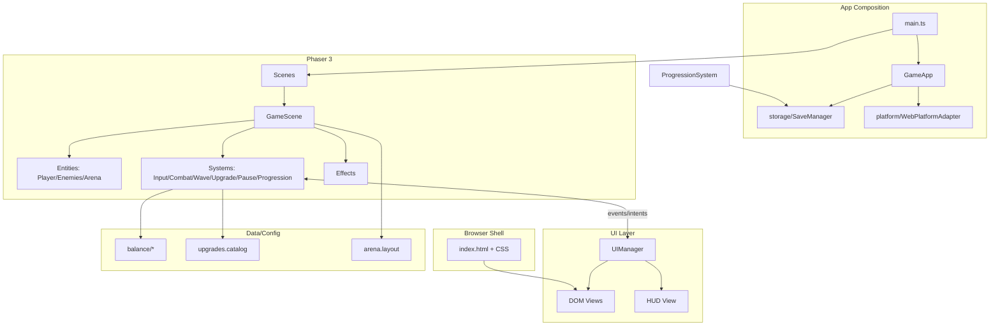
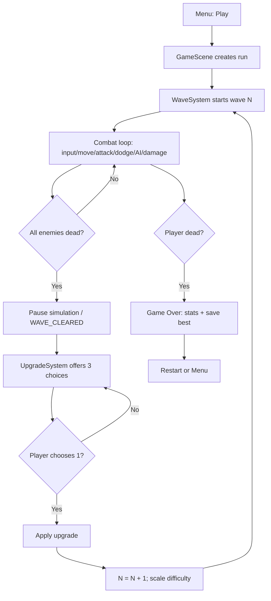
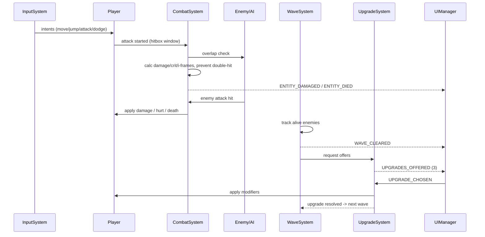
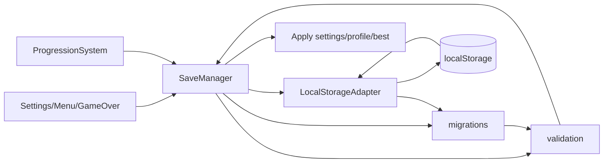

# BLOOMORIA — Architecture

> **Status:** Design only (no implementation). This document defines the agreed architecture for BLOOMORIA before any game code, dependencies, or assets are created.

## 1. Project Description

**BLOOMORIA** is a browser-based 2D side-view arena hack-and-slash platformer. The player controls a sword fighter on a fixed arena, survives endless enemy waves, and strengthens the character by choosing one upgrade after each completed wave.

- **Genre:** 2D Side-View Arena Hack & Slash Platformer
- **Mode (MVP):** `ENDLESS WAVES` only
- **Target platforms:** Desktop Browser, Mobile Browser, HTML5 gaming portals
- **Visual direction:** Minimalist Geometric Fantasy — all visuals are procedural (Phaser graphics/primitives/particles/animations). **No raster images, no spritesheets, no external art assets.**
- **Commercial direction:** Portal-friendly build with future ad/IAP integration via a platform abstraction (no SDKs now).

## 2. Technology Stack

| Technology         | Purpose                                                 | Status      |
| ------------------ | ------------------------------------------------------- | ----------- |
| TypeScript         | Primary development language, contracts/config typing   | Required    |
| JavaScript ES2022+ | Runtime target                                          | Required    |
| HTML5              | Browser shell, canvas host, overlay mount points        | Required    |
| CSS3               | App/UI styling (menus, overlays, HUD where appropriate) | Required    |
| Phaser 3           | Game loop, rendering, physics, input, scenes, particles | Required    |
| Vite               | Dev server and production bundling                      | Required    |
| npm                | Dependency management                                   | Required    |
| ESLint             | Static analysis                                         | Recommended |
| Prettier           | Formatting                                              | Recommended |

**Explicitly out of scope (not added without proven need):** React, Redux, Zustand, Supabase, Firebase, PostgreSQL, backend services, ad SDKs, asset pipelines for raster art.

**Responsibility split:** Phaser owns simulation/rendering inside the game canvas. HTML/CSS may own shell-level UI (loading/menu/settings overlays) where it improves clarity and avoids overloading Phaser with app chrome. Game-critical HUD can be Phaser or DOM; the architecture allows either via a UI adapter boundary (decision documented in §14).

## 3. Architectural Principles

1. **Minimal surface area:** few files, few dependencies, no speculative abstractions.
2. **Human-readable structure:** a new developer can locate responsibility by folder name.
3. **Single responsibility per module:** no “god” files mixing unrelated systems.
4. **No duplicated game logic:** damage, wave scaling, upgrade application, and state transitions live in one place each.
5. **Data separated from behavior:** balance/config in `data/`; systems consume it.
6. **Platform independence of core logic:** gameplay rules do not import portal/ad APIs directly.
7. **Predictable lifecycle:** explicit create/update/destroy/pause behavior; pooled objects are reset safely.
8. **Extensible, not over-engineered:** adding an enemy type or upgrade should not require rewriting core systems.
9. **Performance-aware by design:** object pools, capped entities/particles, delta-time correctness, no per-frame allocations in hot paths where avoidable.
10. **Safety for saves:** versioned, validated local data; corrupted saves fall back safely.

## 4. Directory Tree

```text
BLOOMORIA/
├─ index.html                         # Vite entry HTML: canvas mount + UI overlay roots
├─ package.json                       # Scripts/deps (created only at implementation start)
├─ tsconfig.json                      # TS compiler options (implementation start)
├─ vite.config.ts                     # Vite/Phaser bundling config (implementation start)
├─ .eslintrc.*                        # Lint rules (optional, implementation start)
├─ .prettierrc*                       # Formatting rules (optional)
├─ public/                            # Static files served as-is (favicon/legal text later if needed)
│  └─ .gitkeep                        # Keeps folder if empty; no raster art assets
├─ src/
│  ├─ main.ts                         # App bootstrap: create Phaser.Game, wire platform/storage adapters
│  ├─ app/
│  │  ├─ GameApp.ts                   # Top-level composition root; initializes services/managers
│  │  └─ AppConfig.ts                 # Canvas size, scale mode, debug flags (non-balance)
│  ├─ core/
│  │  ├─ types.ts                     # Shared domain types/enums (GamePhase, IDs, vectors where useful)
│  │  ├─ events.ts                    # Typed event names/payload contracts for decoupled comms
│  │  ├─ StateMachine.ts              # Small reusable FSM helper (generic, no game rules inside)
│  │  └─ ObjectPool.ts                # Generic pool for projectiles/effects/enemies if needed
│  ├─ scenes/
│  │  ├─ BootScene.ts                 # Minimal boot; registers services; transitions to Preload/Menu
│  │  ├─ PreloadScene.ts              # Procedural texture/shape setup hooks; no image loading
│  │  ├─ MenuScene.ts                 # Main menu scene (or triggers DOM menu)
│  │  ├─ GameScene.ts                 # Arena gameplay: wires entities/systems per run
│  │  └─ UIScene.ts                   # Optional Phaser HUD overlay scene (only if HUD is canvas-based)
│  ├─ entities/
│  │  ├─ player/
│  │  │  ├─ Player.ts                 # Player entity: state, stats view, movement/combat intents
│  │  │  ├─ PlayerView.ts             # Procedural visual (geometric parts) + animations
│  │  │  └─ PlayerState.ts            # Player FSM states/transitions (uses core FSM helper)
│  │  ├─ enemies/
│  │  │  ├─ Enemy.ts                  # Base enemy entity/runtime wrapper
│  │  │  ├─ EnemyView.ts              # Procedural enemy visuals by type
│  │  │  ├─ EnemyAI.ts                # Enemy FSM/behavior (approach/attack/cooldown)
│  │  │  └─ EnemyFactory.ts           # Creates configured enemies (uses pools/config)
│  │  └─ arena/
│  │     └─ Arena.ts                  # Fixed arena geometry/platforms/spawn points setup
│  ├─ systems/
│  │  ├─ InputSystem.ts               # Unifies keyboard/touch into gameplay intents
│  │  ├─ CombatSystem.ts              # Attack/hit resolution, damage application, crits, i-frames rules
│  │  ├─ WaveSystem.ts                # Wave progression, spawn scheduling, completion detection
│  │  ├─ UpgradeSystem.ts             # Roll 3 upgrades, validate choice, apply effects
│  │  ├─ ProgressionSystem.ts         # Run stats/XP hooks (minimal MVP) and best-result updates
│  │  └─ PauseSystem.ts               # Pause/resume rules; blocks conflicting transitions
│  ├─ ui/
│  │  ├─ UIManager.ts                 # Shows/hides screens; subscribes to game events
│  │  ├─ dom/
│  │  │  ├─ MenuView.ts               # DOM main menu
│  │  │  ├─ UpgradeView.ts            # DOM upgrade selection (3 cards, mandatory)
│  │  │  ├─ PauseView.ts              # DOM pause/settings overlay
│  │  │  └─ GameOverView.ts           # DOM defeat/results screen
│  │  ├─ hud/
│  │  │  └─ HudView.ts                # HUD presentation (DOM or Phaser adapter impl; one chosen)
│  │  └─ styles/
│  │     └─ ui.css                    # UI layout, hierarchy, hover/active/disabled, transitions
│  ├─ effects/
│  │  ├─ EffectsManager.ts            # Spawns visual feedback (hit sparks, damage numbers optional later)
│  │  └─ ProceduralFx.ts              # Small helpers for particles/tweens/flash using primitives
│  ├─ data/
│  │  ├─ balance/
│  │  │  ├─ player.balance.ts         # Player base stats/constants
│  │  │  ├─ enemies.balance.ts        # Enemy base configs (Grunt/Runner/Tank/Elite)
│  │  │  └─ waves.balance.ts          # Wave formulas, caps, spawn pacing
│  │  ├─ upgrades/
│  │  │  └─ upgrades.catalog.ts       # Upgrade definitions, rarity, constraints, effect descriptors
│  │  ├─ settings/
│  │  │  └─ defaults.ts               # Default audio/fullscreen/quality/control settings
│  │  └─ arena/
│  │     └─ arena.layout.ts           # Fixed arena dimensions, platforms, spawn points (data only)
│  ├─ storage/
│  │  ├─ SaveManager.ts               # High-level save/load for profile, settings, best result
│  │  ├─ LocalStorageAdapter.ts       # localStorage read/write; namespaced keys
│  │  ├─ migrations.ts                # Save schema version migrations
│  │  └─ validation.ts                # Guards against corrupted/invalid payloads
│  ├─ platform/
│  │  ├─ PlatformAdapter.ts           # Interface/contract for future portal/ad/IAP hooks
│  │  └─ WebPlatformAdapter.ts        # No-op/default web implementation
│  └─ input/
│     ├─ KeyboardInput.ts             # Desktop key mapping/state
│     ├── TouchInput.ts               # Virtual joystick/buttons (mobile)
│     └─ InputMapper.ts               # Maps raw input to actions (move/jump/attack/dodge/ability/pause)
├─ docs/
│  ├─ ARCHITECTURE.md                 # This document
│  └─ DEVELOPMENT_PLAN.md             # Phased implementation plan
└─ .gitignore                         # node_modules/dist/etc. (implementation start)
```

### Directory/File Responsibilities

| Path                               | Exists for       | Responsibility                                 | Tasks (future implementation)                          | Depends on                    | Depended on by                      |
| ---------------------------------- | ---------------- | ---------------------------------------------- | ------------------------------------------------------ | ----------------------------- | ----------------------------------- |
| `index.html`                       | Browser entry    | Host canvas and DOM UI roots; load Vite module | Mount points, minimal shell markup                     | Vite                          | `src/main.ts`                       |
| `src/main.ts`                      | Bootstrap        | Create app, start Phaser with config           | Instantiate adapters/services, start BootScene         | `app/*`, Phaser               | —                                   |
| `src/app/GameApp.ts`               | Composition root | Own shared service instances                   | Wire SaveManager, PlatformAdapter, event bus           | `storage`, `platform`, `core` | scenes/systems via access pattern   |
| `src/app/AppConfig.ts`             | Runtime config   | Canvas/scale/debug constants                   | Responsive scale settings                              | —                             | `main.ts`                           |
| `src/core/types.ts`                | Shared contracts | Enums/types used across modules                | `GamePhase`, entity IDs, stat shapes                   | —                             | most modules                        |
| `src/core/events.ts`               | Decoupling       | Event names and payload types                  | Wave complete, player hurt, run ended, upgrade chosen  | `types`                       | systems, UI, scenes                 |
| `src/core/StateMachine.ts`         | Reusable FSM     | Generic transitions/guards                     | Enter/exit hooks, allowed transitions                  | —                             | player/enemy/pause/game phase logic |
| `src/core/ObjectPool.ts`           | Performance      | Reuse transient objects                        | Acquire/release/reset                                  | —                             | effects, enemy/projectile spawning  |
| `src/scenes/BootScene.ts`          | Startup          | Register globals/services                      | Minimal init                                           | `app`                         | Phaser                              |
| `src/scenes/PreloadScene.ts`       | Setup            | Procedural graphics/textures generation        | Generate primitive textures/animations                 | Phaser Graphics               | Phaser                              |
| `src/scenes/MenuScene.ts`          | Navigation       | Start run / open settings/profile              | Transition to GameScene                                | UI/events                     | Phaser                              |
| `src/scenes/GameScene.ts`          | Gameplay host    | Create arena/entities/systems for a run        | Scene lifecycle, update loop delegation                | entities, systems, data       | Phaser                              |
| `src/scenes/UIScene.ts`            | Optional HUD     | Canvas HUD if chosen                           | Render HUD independently                               | core/events                   | Phaser                              |
| `src/entities/player/*`            | Player domain    | Player runtime, visuals, state                 | Move/jump/attack/dodge/death                           | core, data, systems contracts | `GameScene`, systems                |
| `src/entities/enemies/*`           | Enemy domain     | Enemy runtime, AI, visuals, spawning           | Behavior, attacks, death                               | core, data, pool              | `WaveSystem`, `CombatSystem`        |
| `src/entities/arena/Arena.ts`      | Level            | Fixed platforms/bounds/spawn markers           | Build static geometry/colliders                        | `data/arena`, Phaser          | `GameScene`                         |
| `src/systems/InputSystem.ts`       | Input            | Convert device input to intents                | Merge keyboard/touch, handle simultaneous keys         | `input/*`                     | `GameScene`, player                 |
| `src/systems/CombatSystem.ts`      | Combat rules     | Hit detection, damage, crit, i-frames          | Melee hitbox checks, apply damage once per swing       | core/events, entities         | `GameScene`                         |
| `src/systems/WaveSystem.ts`        | Wave flow        | Spawn/scale/complete waves                     | N(w), HP/DMG scaling, caps                             | `data/waves`, `EnemyFactory`  | `GameScene`                         |
| `src/systems/UpgradeSystem.ts`     | Upgrades         | Roll/apply/validate upgrades                   | 3 choices, rarity/compat rules                         | `data/upgrades`, player stats | `GameScene`, UI                     |
| `src/systems/ProgressionSystem.ts` | Run meta         | Track kills/time/damage/best                   | Update run stats; request save on game over            | core/events, storage          | `GameScene`, UI                     |
| `src/systems/PauseSystem.ts`       | Flow control     | Pause-safe transitions                         | Block pause during upgrade choice conflicts as defined | core FSM/events               | scenes/UI                           |
| `src/ui/UIManager.ts`              | UI orchestration | Bridge game events <-> views                   | Show upgrade/game over/pause                           | `core/events`, views          | scenes/systems                      |
| `src/ui/dom/*`                     | DOM screens      | Accessible/clear app UI                        | Menu, upgrades, pause, game over                       | `ui.css`, events              | `UIManager`                         |
| `src/ui/hud/*`                     | HUD              | Live combat info                               | HP, wave, kills, time, abilities, pause button         | events/state                  | `UIManager`                         |
| `src/ui/styles/ui.css`             | Visual system    | Consistent UI styling                          | Hierarchy, states, transitions, responsive             | —                             | DOM views                           |
| `src/effects/*`                    | Feedback         | Non-gameplay visuals                           | Hit flashes, particles, telegraphs                     | core pool, Phaser             | combat/wave/player/enemy            |
| `src/data/**`                      | Balance/config   | Tunable values and catalogs                    | Stats, formulas, upgrades, defaults, layout            | `core/types`                  | systems/entities                    |
| `src/storage/*`                    | Persistence      | Local save lifecycle                           | Save/load/migrate/validate settings & records          | `data/settings` defaults      | `app`, progression, UI              |
| `src/platform/*`                   | Portability      | Future platform hooks                          | No-op now; adapter contract                            | —                             | `app`, future ads/rewards           |
| `src/input/*`                      | Device input     | Raw input capture/mapping                      | Keyboard + touch virtual controls                      | browser APIs/Phaser input     | `InputSystem`                       |
| `docs/*`                           | Documentation    | Architecture & plan                            | Keep design decisions current                          | —                             | developers                          |

## 5. Architectural Modules

| Module     | Purpose                                                                           | Rationale                                                                             | Merge considered?                                                                                                   |
| ---------- | --------------------------------------------------------------------------------- | ------------------------------------------------------------------------------------- | ------------------------------------------------------------------------------------------------------------------- |
| `core`     | Shared primitives: types, events, FSM helper, pool                                | Prevents duplication and circular imports; keeps generic helpers out of gameplay code | Keep small; do not split into many micro-packages                                                                   |
| `scenes`   | Phaser scene lifecycle                                                            | Phaser’s natural entry points; each scene has a narrow role                           | `UIScene` optional/mergeable into DOM HUD                                                                           |
| `entities` | Player, enemies, arena runtime objects                                            | Groups “things that exist in the world” with their views/state                        | Could be flatter, but player/enemy complexity justifies subfolders                                                  |
| `systems`  | Gameplay rules/orchestration (input, combat, waves, upgrades, pause, progression) | Keeps rules testable/logical and out of entity/render code                            | Merge only if a system stays trivial (e.g., Progression into Wave/Game over handler) — decide during implementation |
| `ui`       | Screens and HUD presentation                                                      | Isolates UX from simulation; supports DOM/CSS polish                                  | DOM views + one HUD path; avoid parallel UI frameworks                                                              |
| `effects`  | Visual feedback                                                                   | Centralizes particles/tweens; easy to cap for performance                             | Could live in systems, but separating FX avoids bloating combat/wave code                                           |
| `data`     | Balance/catalog/layout/defaults                                                   | Mandatory separation of parameters from logic                                         | —                                                                                                                   |
| `storage`  | Local persistence                                                                 | Versioning/validation/migration complexity isolated from gameplay                     | —                                                                                                                   |
| `platform` | Portal/ads/IAP future boundary                                                    | Gameplay must not know portal SDKs                                                    | —                                                                                                                   |
| `input`    | Device-specific capture/mapping                                                   | Desktop/mobile differences isolated from combat/player                                | —                                                                                                                   |

**Intentional non-modules (YAGNI):** no `abilities/` framework, no backend/auth implementation, no ECS library, no global state store, no asset loader module for raster art.

## 6. Module Interactions

### Ownership and responsibilities

- **`main.ts` / `GameApp`**: composition root. Creates `SaveManager`, `PlatformAdapter` (web no-op), and provides access to shared services (simple app context object; no DI framework).
- **`GameScene`**: owns the _current run_ composition. Creates `Arena`, `Player`, `EnemyFactory`, and system instances; delegates `update(time, delta)`.
- **Entity lifecycle**:
  - `Arena`: created once per `GameScene` run; static for the run.
  - `Player`: created once per run; destroyed/reset on scene shutdown.
  - `Enemies`: created via `EnemyFactory`/pool; released on death/despawn; all cleared on run end.
- **Collisions**: Phaser Arcade Physics (planned) handles overlaps/colliders; `CombatSystem` interprets combat-relevant overlaps (player attack hitbox vs enemies, enemy attack/hazard vs player) and applies rules. Static arena colliders set up by `Arena`.
- **Damage calculation**: only `CombatSystem` computes final damage (base, upgrades, crit multiplier, defense reduction, clamps) and emits events (`ENTITY_DAMAGED`, `ENTITY_DIED`). It enforces “one hit per swing per target” using a per-attack hit set.
- **Waves**: `WaveSystem` owns wave number, spawn queue/timers, alive-enemy tracking, scaling formulas/caps, and emits `WAVE_STARTED`, `WAVE_CLEARED`.
- **Upgrade generation**: `UpgradeSystem` rolls 3 offers from `upgrades.catalog.ts` using rarity weights + constraints (no incompatible duplicates, respect max stacks/locks, consider already chosen). It emits `UPGRADES_OFFERED`.
- **Upgrade application**: `UpgradeSystem` applies the chosen upgrade to player/run modifiers (data-driven effect descriptors) and emits `UPGRADE_APPLIED`. It does **not** start the next wave; `GameScene`/run flow does after choice.
- **Saves**: `SaveManager` owns load/save of settings, guest profile, best results. `ProgressionSystem`/game-over flow requests save through `SaveManager`. Storage never mutates gameplay directly.
- **UI events**: systems/scenes emit typed events; `UIManager` subscribes and updates DOM/HUD views. UI sends intents back (Play, Pause, Resume, Choose Upgrade, Restart, Settings change) via callbacks/events — UI never directly changes enemy HP or wave logic.

### Mermaid: Overall Architecture



### Mermaid: Game Loop (Run Flow)



### Mermaid: Gameplay Systems Interaction



### Mermaid: Save/Progress Flow



## 7. Core TypeScript Contracts (Conceptual)

These are _design contracts_ only — names/shapes may be refined at implementation time, but responsibilities must remain stable.

```ts
// core/types.ts (conceptual)
export type EntityId = string;

export enum GamePhase {
  BOOT = 'BOOT',
  PRELOAD = 'PRELOAD',
  MENU = 'MENU',
  RUNNING = 'RUNNING',
  WAVE_CLEAR = 'WAVE_CLEAR',
  UPGRADE_SELECTION = 'UPGRADE_SELECTION',
  PAUSED = 'PAUSED',
  GAME_OVER = 'GAME_OVER',
}

export enum PlayerStateId {
  IDLE = 'IDLE',
  MOVING = 'MOVING',
  JUMPING = 'JUMPING',
  FALLING = 'FALLING',
  ATTACKING = 'ATTACKING',
  DODGING = 'DODGING',
  HURT = 'HURT',
  DEAD = 'DEAD',
}

export enum EnemyStateId {
  SPAWNING = 'SPAWNING',
  APPROACHING = 'APPROACHING',
  ATTACKING = 'ATTACKING',
  COOLDOWN = 'COOLDOWN',
  DEAD = 'DEAD',
}

export enum EnemyType {
  GRUNT = 'GRUNT',
  RUNNER = 'RUNNER',
  TANK = 'TANK',
  ELITE = 'ELITE',
}

export enum UpgradeCategory {
  ATTACK = 'ATTACK',
  CRITICAL = 'CRITICAL',
  HEALTH = 'HEALTH',
  DEFENSE = 'DEFENSE',
  MOVEMENT = 'MOVEMENT',
  DODGE = 'DODGE',
  ABILITIES = 'ABILITIES',
  RECOVERY = 'RECOVERY',
}

export enum UpgradeRarity {
  COMMON = 'COMMON',
  RARE = 'RARE',
  EPIC = 'EPIC',
}

// data/player / runtime stats
export interface PlayerStats {
  maxHp: number;
  hp: number;
  swordDamage: number;
  moveSpeed: number; // px/s
  jumpSpeed: number; // px/s
  critChance: number; // 0..1
  critMultiplier: number;
  attackCooldownMs: number;
  dodgeDurationMs: number;
  dodgeCooldownMs: number;
  invulnerabilityMs: number;
  incomingDamageMultiplier: number; // defense modifier
  abilityDamageMultiplier: number;
}

// entities/enemies
export interface EnemyConfig {
  type: EnemyType;
  maxHp: number;
  damage: number;
  speed: number;
  attackRange: number;
  attackCooldownMs: number;
  // visual/AI tuning fields added as needed, kept data-driven
}

export interface Enemy {
  id: EntityId;
  type: EnemyType;
  hp: number;
  maxHp: number;
  config: EnemyConfig;
  state: EnemyStateId;
  // runtime refs (body/view) are implementation details, not exposed globally
}

export interface Player {
  id: EntityId;
  stats: PlayerStats;
  state: PlayerStateId;
  // methods omitted by design; systems/entities coordinate behavior
}

// systems/progression
export interface RunStatistics {
  waveReached: number;
  kills: number;
  survivalMs: number;
  damageDealt: number;
  damageTaken: number;
}

export interface RunState {
  phase: GamePhase;
  wave: number;
  isPaused: boolean;
  upgradePending: boolean;
  selectedUpgradeIds: string[];
  statistics: RunStatistics;
}

// data/upgrades
export interface UpgradeEffect {
  kind: string; // e.g. 'stat_mult', 'stat_add', 'heal_percent' (typed union later)
  target: string; // e.g. 'swordDamage', 'critChance'
  value: number;
}

export interface Upgrade {
  id: string;
  name: string;
  description: string;
  category: UpgradeCategory;
  rarity: UpgradeRarity;
  maxStacks?: number;
  effects: UpgradeEffect[];
  incompatibleWith?: string[]; // upgrade ids/tags
}

// storage
export interface SaveData {
  schemaVersion: number;
  profile: {
    mode: 'guest' | 'registered_future';
    displayName: string;
    createdAt: string;
  };
  settings: {
    musicVolume: number;
    sfxVolume: number;
    fullscreen: boolean;
    quality: 'low' | 'medium' | 'high';
    controlHints: 'auto' | 'desktop' | 'mobile';
  };
  best: {
    wave: number;
    kills: number;
    survivalMs: number;
  };
}

// platform
export interface PlatformAdapter {
  initialize(): Promise<void>;
  showInterstitial?(placement: string): Promise<void>;
  showRewarded?(placement: string): Promise<{ rewarded: boolean }>;
  canPurchase?(): boolean;
  // no SDK imports in game logic; web no-op implements safely
}

// input
export interface InputActions {
  left: boolean;
  right: boolean;
  jumpPressed: boolean;
  jumpHeld: boolean;
  attackPressed: boolean;
  dodgePressed: boolean;
  ability1Pressed: boolean;
  ability2Pressed: boolean;
  pausePressed: boolean;
  moveAxisX: number; // -1..1 (keyboard/touch unified)
}

export interface InputController {
  update(): void;
  getActions(): InputActions;
  destroy(): void;
}
```

**Notes:**

- `UpgradeEffect.kind/target` should become a strict discriminated union during implementation to avoid stringly-typed bugs.
- Runtime Phaser objects (`Sprite`, `Body`, containers) stay inside entity/view classes; contracts expose domain state, not engine internals.
- Abilities (Q/E) are mapped in input/UI now but ability execution can be a minimal placeholder in MVP unless explicitly prioritized later — architecture reserves hooks without building a full skill system.

## 8. Game States and Transitions

### Application phases (`GamePhase`)

| Phase               | Meaning                                   | Allowed transitions                                          |
| ------------------- | ----------------------------------------- | ------------------------------------------------------------ |
| `BOOT`              | App/service init                          | → `PRELOAD`                                                  |
| `PRELOAD`           | Procedural setup                          | → `MENU`                                                     |
| `MENU`              | Main menu                                 | → `RUNNING`                                                  |
| `RUNNING`           | Active combat/simulation                  | → `WAVE_CLEAR`, `PAUSED`, `GAME_OVER`                        |
| `WAVE_CLEAR`        | Wave finished, simulation stopped         | → `UPGRADE_SELECTION`                                        |
| `UPGRADE_SELECTION` | Mandatory pick 1 of 3; simulation stopped | → `RUNNING` (only after valid choice)                        |
| `PAUSED`            | User pause overlay; simulation stopped    | → previous resumable phase (`RUNNING` only in MVP) or `MENU` |
| `GAME_OVER`         | Run ended; results shown                  | → `RUNNING` (restart) or `MENU`                              |

### Conflict rules (critical)

- **Upgrade selection is mandatory and exclusive:** no next wave, no combat updates, no enemy spawns while in `UPGRADE_SELECTION`.
- **Pause during upgrade selection:** either disallowed or implemented as a nested UI state that does not resume simulation; recommended MVP behavior: ignore gameplay pause toggle while upgrade modal is active (pause button can be disabled/hidden) to avoid conflicting resume targets.
- **Pause during wave clear transition:** treat as `WAVE_CLEAR`/`UPGRADE_SELECTION` flow; do not resume combat.
- **Game over overrides:** when player reaches 0 HP, transition to `GAME_OVER` from `RUNNING`; ignore late input except UI actions.
- **Single active run scene:** restarting creates a clean run state; pooled objects reset; timers/listeners removed.

### Player states

`IDLE ↔ MOVING`, `MOVING/IDLE → JUMPING`, `JUMPING → FALLING`, `FALLING → IDLE/MOVING` (land), `IDLE/MOVING/JUMPING/FALLING → ATTACKING` (if cooldown ready), `ATTACKING → IDLE/FALLING` (attack end), `IDLE/MOVING/JUMPING/FALLING → DODGING` (if cooldown ready), `DODGING → IDLE/FALLING`, `ANY non-DEAD → HURT` (if damage taken and not invulnerable; may be brief overlay or cancel rules defined later), `ANY → DEAD` (HP <= 0). `DEAD` is terminal for the run.

### Enemy states

`SPAWNING → APPROACHING`, `APPROACHING → ATTACKING` (in range/ready), `ATTACKING → COOLDOWN`, `COOLDOWN → APPROACHING/ATTACKING`, `ANY → DEAD` (HP <= 0). `DEAD` triggers cleanup/release.

## 9. Data Organization

| Data                      | Location                                | Consumed by                      | Notes                                                               |
| ------------------------- | --------------------------------------- | -------------------------------- | ------------------------------------------------------------------- |
| Player base balance       | `src/data/balance/player.balance.ts`    | Player init, UpgradeSystem       | Starting HP/damage/speeds/cooldowns/crit/i-frames                   |
| Enemy balance/config      | `src/data/balance/enemies.balance.ts`   | EnemyFactory, WaveSystem scaling | Grunt/Runner/Tank/Elite base stats + behavior tuning params         |
| Wave config/formulas      | `src/data/balance/waves.balance.ts`     | WaveSystem                       | `N(w)`, HP/DMG scaling, spawn interval, max alive cap, scaling caps |
| Upgrade catalog           | `src/data/upgrades/upgrades.catalog.ts` | UpgradeSystem                    | IDs, names, descriptions, rarity, category, effects, constraints    |
| UI/game settings defaults | `src/data/settings/defaults.ts`         | SaveManager, settings UI         | Music/SFX/fullscreen/quality/controls                               |
| Arena layout              | `src/data/arena/arena.layout.ts`        | Arena builder                    | Fixed world bounds, platform rects, spawn points                    |
| Runtime run state         | in-memory (`RunState`)                  | systems/UI                       | Not persisted mid-run in MVP                                        |
| Local persistence         | localStorage via SaveManager            | menu/settings/progression        | Versioned `SaveData`; no backend                                    |

**Rule:** systems read config; systems do not embed magic balance numbers except engine/constants with clear names. Config files export plain typed objects/constants.

## 10. Persistence Design

- **Storage:** `localStorage` only (MVP). Keys namespaced (e.g., `bloomoria.save.v1`).
- **SaveData:** schema version, guest profile stub, settings, best results. Run-in-progress persistence is _not_ required for MVP.
- **Validation:** `validation.ts` checks shape/ranges/enums; invalid fields fall back to defaults; never trust raw JSON.
- **Migrations:** `migrations.ts` upgrades older schema versions forward; unknown future versions fall back safely (read-only defaults + warning log).
- **Corruption handling:** JSON parse errors or failed validation → backup bad payload key (optional) and load defaults; game remains playable.
- **Future AuthProvider:** define a seam where `profile.mode` can become registered and saves can sync. **Not implemented now.** No backend, no OAuth, no database.

## 11. Implementation Order (Summary)

Detailed phased plan is in `docs/DEVELOPMENT_PLAN.md`. High-level sequence:

1. Tooling/bootstrap (Vite+TS+Phaser shell, config, lint/format) — _after explicit approval_.
2. Core/app skeleton + scenes + fixed arena + procedural placeholders.
3. Input + player movement/jump/states.
4. Combat (attack hitbox, damage, crit, i-frames) + basic enemy.
5. Enemy types/AI + pooling.
6. Wave system + scaling/caps.
7. Upgrade catalog/generation/application + mandatory upgrade flow.
8. UI/HUD/menus/settings/game over polish.
9. SaveManager + localStorage + validation/migrations.
10. Performance pass, mobile controls, QA, portal-readiness seams.

## 12. MVP Readiness Criteria

- Runs in desktop and mobile browsers via Vite build/static hosting.
- Fixed arena; player can move, jump, attack, dodge; states behave predictably.
- Four enemy types (Grunt/Runner/Tank/Elite) spawn and act by FSM behaviors.
- Endless waves scale using defined formulas with caps; wave only advances after all enemies are dead.
- After each wave: simulation pauses, exactly 3 upgrades shown, one mandatory choice, next wave starts only after choice.
- Upgrades modify stats/effects without central rewrites; no duplicate damage per single swing.
- HUD shows HP, wave, kills, survival time; pause and settings work; game over shows required stats and best result.
- Guest profile/settings/best saved in localStorage with versioning and safe fallback on corruption.
- No raster/external art assets; procedural geometric visuals and effects.
- Stable performance target: 60 FPS goal, acceptable 30 FPS on weaker devices; no obvious leaks; object pooling where needed.

## 13. Technical Decisions Requiring Confirmation

1. **HUD implementation:** DOM/CSS HUD vs Phaser `UIScene` HUD. _Recommendation:_ DOM/CSS for menus/settings/upgrade/game-over; HUD can be DOM (simpler responsive styling) or a lightweight Phaser HUD — pick one before implementation to avoid duplication.
2. **Physics engine:** Phaser Arcade Physics (simpler/faster for this scope) vs Matter. _Recommendation:_ Arcade Physics for MVP.
3. **Event mechanism:** Phaser’s event emitter vs a tiny typed app event bus in `core/events.ts`. _Recommendation:_ thin typed wrapper around Phaser/EventEmitter pattern for decoupling without a framework.
4. **Ability Q/E in MVP:** input/UI reserved now, but full ability system may be deferred. _Recommendation:_ keep bindings/hooks; implement only if time/scope allows, otherwise no-op with clear TODO boundary (not a new mode/system).
5. **XP field in HUD:** spec lists “опыт, если используется”. _Recommendation:_ omit XP bar in MVP unless a concrete mechanic is approved; keep `ProgressionSystem` extensible.
6. **Damage numbers:** not required; can be expensive/noisy. _Recommendation:_ defer; use simple hit flashes/particles first.
7. **ESLint/Prettier strictness:** recommended but adds setup files. _Recommendation:_ minimal config at bootstrap.

## 14. Final Design Notes

- **No implementation created:** this stage produces architecture documentation only.
- **No dependencies installed:** `package.json`/Phaser/Vite setup described, not executed.
- **Keep it small:** during implementation, if a planned file remains under ~50–80 lines with stable responsibility, it may be merged with a neighbor — but only when it improves clarity.
